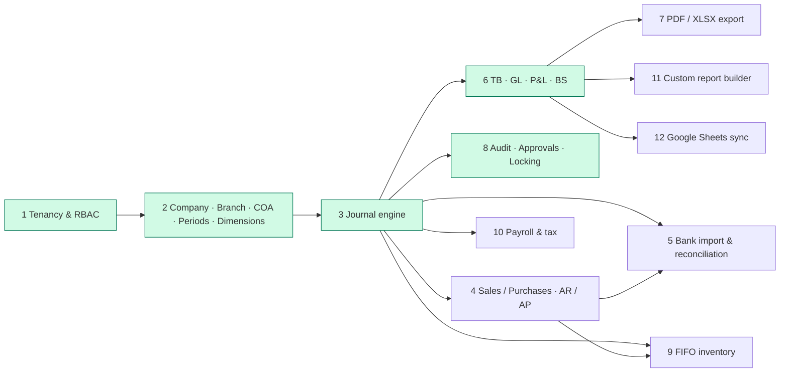
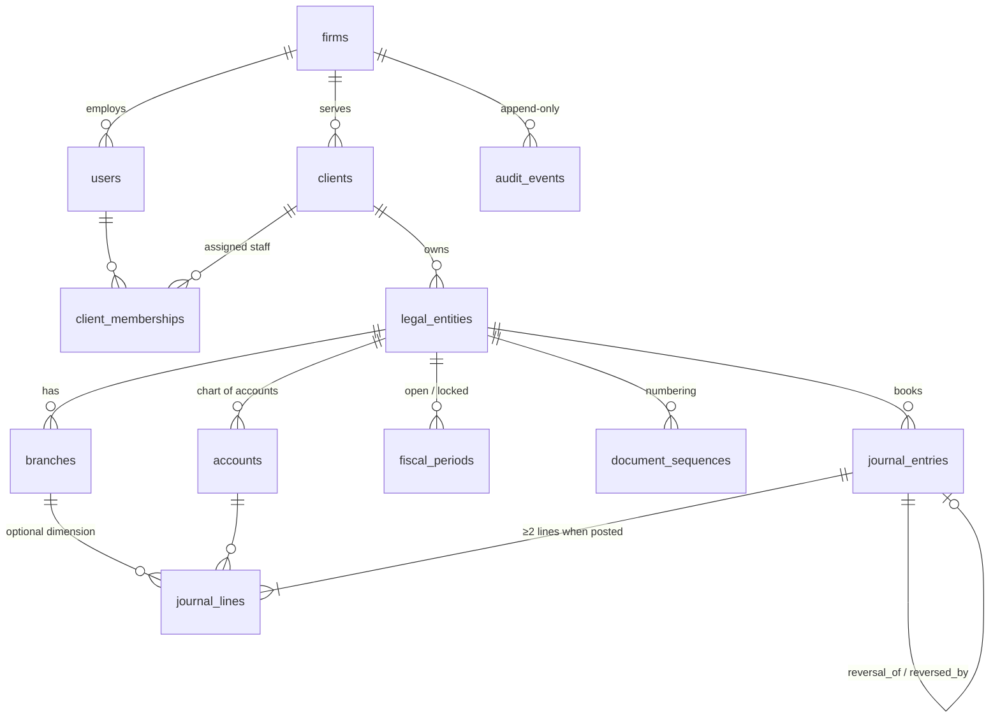

# Accounting OS — Architecture

Modular monolith, multi-tenant, Indonesia-first. Main spec: `.claude/skills/accounting-os-builder` (master prompt, product spec, engineering contracts, quality gates).

```
apps/
  api/    NestJS 11 + PostgreSQL 16 (pg, SQL migrations, RLS)   → /api/v1, OpenAPI at /api/docs
  web/    Next.js 15 App Router + Tailwind                      → proxies /api/v1/* to the API (same-origin cookie)
  lite/   Original single-user Vite app (localStorage), kept working and deployed as before
design-system/accounting-os/MASTER.md   UI tokens & rules (from the ui-ux-pro-max skill)
docs/                                   architecture, module research, status
```

## Module dependency map



Green = first vertical slice implemented (partially for 2, 6 and 8 — see `docs/STATUS.md`). Every later module posts through the same journal engine, so ledger guarantees hold for all of them.

## Entity model (current schema)



All tables carry `firm_id`; child rows reference parents with **composite foreign keys** such as `(entity_id, account_id) → accounts(entity_id, id)`, so a journal line can never point at another company's account, even within the same firm.

## Isolation & security

| Layer | Mechanism |
|---|---|
| Database | `FORCE ROW LEVEL SECURITY` on every tenant table, policy `firm_id = app_firm_id()`; the API connects as a non-superuser role without `BYPASSRLS`. Each request runs in a transaction with `set_config('app.firm_id', …, true)`. |
| Login | A single extra `SELECT` policy on `users` keyed on `app.auth_email`, set only in the login transaction. No `SECURITY DEFINER` functions. |
| Client / company scope | Partner & Manager: all clients of the firm. Accountant & Auditor: only assigned clients (`client_memberships`). Unauthorised ids return **404** (not 403) to prevent probing. |
| Permissions | Role → permission matrix in `apps/api/src/auth/access.service.ts`. |
| Session | HS256 JWT in an `httpOnly`, `SameSite=Lax` cookie (8h) or `Authorization: Bearer`. bcrypt (cost 12), uniform-time login, throttled auth routes. |
| Headers | `X-Frame-Options: DENY`, `nosniff`, `Referrer-Policy`, no `x-powered-by`. |

## Journal engine invariants (enforced in PostgreSQL, not only in code)

| Invariant | Where |
|---|---|
| Amounts are `NUMERIC(20,2)`, serialised as strings; app arithmetic uses `decimal.js` / BigInt cents | schema, `common/validation.ts`, `web/lib/format.ts` |
| A line is debit **xor** credit, non-negative, non-zero | `CHECK` constraints |
| Entries are inserted as `draft`; `posted` only via status transition | trigger `journal_entry_guard` |
| Posting requires ≥2 lines, Σdebit = Σcredit > 0, an existing **open** fiscal period | same trigger, atomic with the status change |
| Lines change only while the entry is a draft; account must be active & postable | trigger `journal_line_guard` |
| Posted entries are immutable; only `posted → reversed` with a linked reversal is allowed | trigger |
| Only drafts can be deleted | trigger |
| Audit events cannot be updated or deleted | trigger `audit_append_only` |
| Fiscal periods of a company cannot overlap | `EXCLUDE USING gist` |
| Gap-free, concurrency-safe numbering `JU/YYYY/00001` | row-locked `document_sequences` |

Workflow: **Draft → Submitted → Approved → Posted → (Reversed)**. Approved ≠ posted. If the company requires approval, posting needs `approved`; the preparer can never approve their own journal (maker-checker). Posting an already-posted journal is a no-op (idempotent), protected by `SELECT … FOR UPDATE`. `POST /journals` accepts `Idempotency-Key`; a retry returns the original journal with `Idempotent-Replayed: true`. Edits use `If-Match: <version>` (409 on conflict).

## API contract (v1, implemented)

All paths are prefixed with `/api/v1`. Errors: `{code, message, issues?}` — 400 validation, 401, 403, 404 (also for other tenants), 409 conflict/duplicate/overlap, 422 accounting rule.

| Area | Endpoints |
|---|---|
| Auth | `POST /auth/register` · `POST /auth/login` · `POST /auth/logout` · `GET /me` |
| Firm | `GET /firm/overview` · `GET /approvals` · `GET /audit` · `GET/POST /staff` · `PATCH /staff/{id}` |
| Clients | `GET/POST /clients` · `GET/PATCH /clients/{id}` · `POST /clients/{id}/members` · `DELETE /clients/{id}/members/{userId}` |
| Companies | `POST /clients/{id}/entities` · `GET/PATCH /entities/{id}` · `GET/POST /entities/{id}/branches` · `PATCH /entities/{id}/branches/{branchId}` |
| COA | `GET/POST /entities/{id}/accounts` (`?asOf=`) · `PATCH /entities/{id}/accounts/{accountId}` |
| Periods | `GET /entities/{id}/periods` · `POST …/periods/generate` · `POST …/periods/{pid}/lock` · `POST …/periods/{pid}/reopen` (reason required) |
| Journals | `GET/POST /entities/{id}/journals` · `POST …/journals/preview` · `GET/PUT/DELETE …/journals/{jid}` · `POST …/journals/{jid}/submit|return|approve|post|reverse` |
| Reports | `GET /entities/{id}/reports/trial-balance|general-ledger|profit-loss|balance-sheet|summary` |
| Audit | `GET /entities/{id}/audit` |
| Ops | `GET /health` · Swagger UI `/api/docs` |
